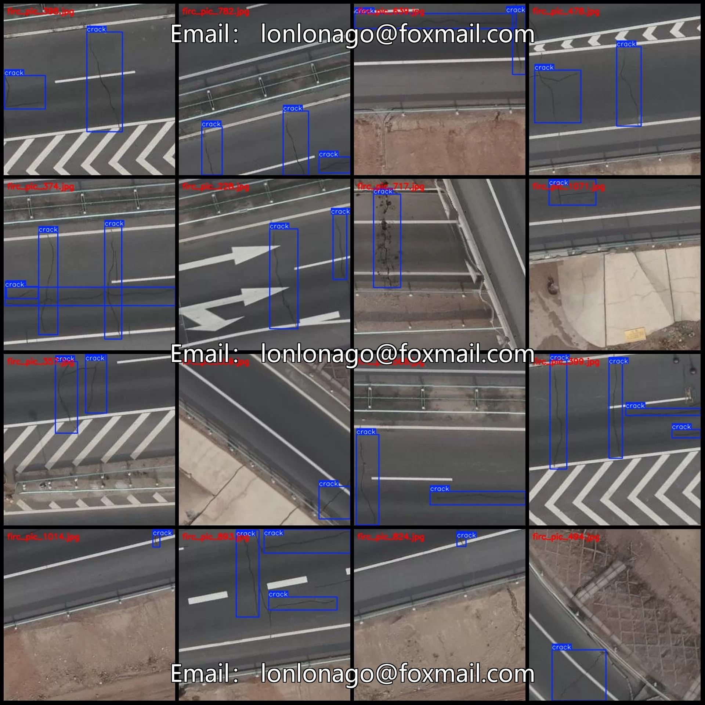
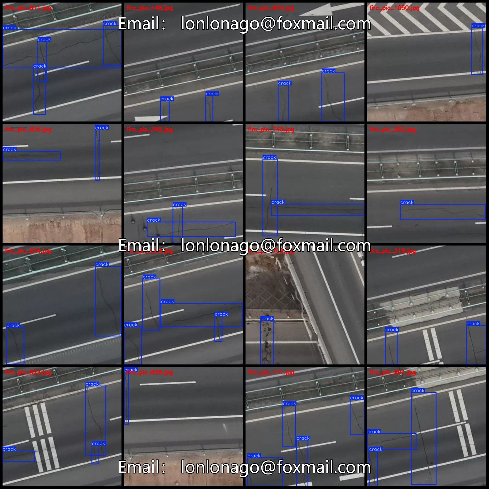
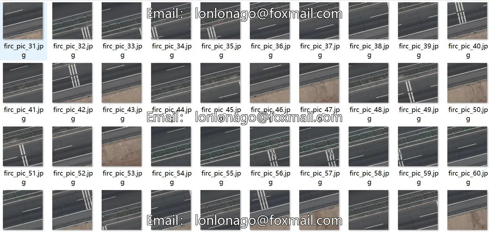
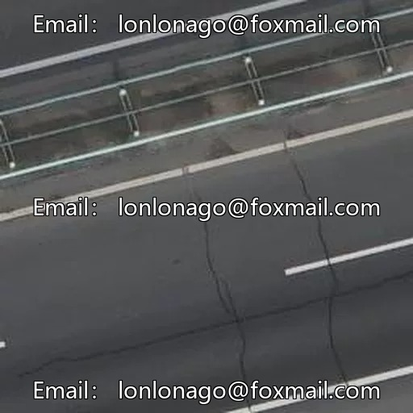
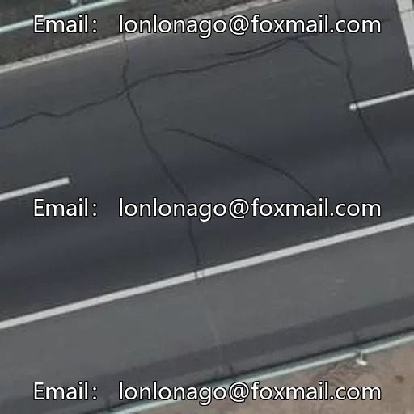

# Drone-view road surface crack detection dataset VOC+YOLO format 1081

## Body

Drone View Road Pavement Crack Detection Dataset VOC+YOLO format: 1081 images in 1 category
Tips: Due to the dataset's replicability, please confirm compliance before purchasing.
Dataset format: Pascal VOC format + YOLO format (txt file without split path, only containing jpg images and corresponding VOC format xml files and yolo format txt files)
Number of images (number of jpg files): 1081
Number of annotations (number of xml files): 1081
Number of annotations (number of txt files): 1081
Number of annotation categories: 1
Annotation category name: ["crack"]
Number of bounding boxes per category
crack = 2495

Total number of frames: 2495
Number of images per category
Cracks: 1081
Image resolution: 512x512
Labeling tool used: labelImg
Labeling rules: Draw a rectangle around the category.
Important note: The dataset does not have separate training, validation, and test sets; you need to partition them yourself.
Special statement: This dataset does not guarantee the accuracy of the trained models or weight files.

## Images

## Payment

Here is a pay link on Stripe ( https://buy.stripe.com/3cs8yP7sY87d0vu9AB ). Please contact me lonlonago@foxmail.com after funding $89, and I will send you a complete data files , thank you!

